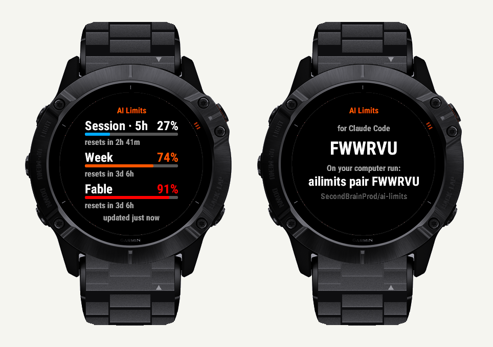
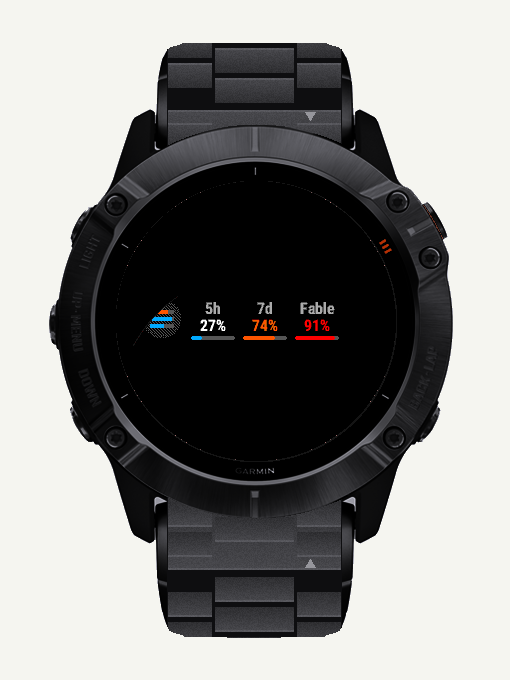

# AI Limits

Your Claude Code usage limits on a Garmin watch: the 5-hour session, the week and the per-model week, with the time until each one resets.



In the widget loop, the glance shows all three limits at once:



> Unofficial. Uses your local Claude Code token only to read your usage limits; the token never leaves your computer. May stop working if Anthropic changes its API. Not affiliated with Anthropic.

AI Limits has three parts:

- **the watch widget** (Connect IQ) — a glance in the widget loop and a full screen;
- **`ailimits`**, a small helper on the computer where you use Claude Code;
- **the relay** at `ailimits.second-brain.ru`, which passes the numbers from the helper to the watch.

## Install

**macOS and Linux, with Homebrew:**

```sh
brew install SecondBrainProd/tap/ailimits
```

**macOS and Linux, without Homebrew:**

```sh
curl -fsSL https://raw.githubusercontent.com/SecondBrainProd/ai-limits/main/install.sh | sh
```

The script installs `ailimits` into `~/.local/bin` and checks the download against `SHA256SUMS`.

**Windows:** download `ailimits_windows_amd64.zip` from [Releases](https://github.com/SecondBrainProd/ai-limits/releases/latest) and unzip `ailimits.exe` into a folder of your choice. The program is not signed yet, so Windows may show “Windows protected your PC”: click **More info**, then **Run anyway**.

**Watch:** install **AI Limits** from the Connect IQ Store.

## Pair

1. Open AI Limits on your watch. It shows a six-character code.
2. On your computer, run `ailimits pair CODE`.
3. Run `ailimits install-service`, so limits keep updating after you log in.

`ailimits status` shows what the helper sees. `ailimits unpair` disconnects this computer, and the watch shows a new code.

You need Claude Code signed in with a Pro or Max subscription on that computer. The helper reads the same sign-in; if Claude Code is signed out or its token has expired, the helper waits until you open Claude Code again.

## How it works

```
Claude Code sign-in ──(read locally)──► ailimits ──GET api.anthropic.com/api/oauth/usage
                                            │
                                            │ percentages, reset times, model labels
                                            ▼
                                     ailimits.second-brain.ru
                                            ▲
                                            │ every 5 minutes, through the phone
                                      Garmin watch
```

- The helper checks your limits every 5 minutes and sends only the numbers. If Anthropic rate-limits the request, it waits longer before the next try.
- The watch asks the relay every 5 minutes (the Connect IQ minimum) and right away when you open the widget.
- If a window resets while your computer is off, the watch shows 0% on its own.
- Data older than 15 minutes turns grey, and the full screen shows when it was last updated.

## Privacy

- Your Claude token stays on your computer. The helper sends it only to Anthropic, exactly as Claude Code does, and never to the relay. On macOS it reads the token through `/usr/bin/security`, and it never refreshes or rewrites it.
- The relay keeps the latest snapshot of the numbers per helper and random identifiers that pair a watch with a helper. It stores no names, e-mail or account data. Secrets are stored as SHA-256 hashes.
- IP addresses are used in memory for about a minute to rate-limit requests. There is no access log.
- Unpaired watches are deleted after a day; a helper that stays silent for 30 days is deleted together with its snapshot.

The relay is open source too: see [`relay/`](relay).

## Supported watches

fēnix 5, 5S, 5X, 5 Plus series, fēnix 6, 6S, 6X series, fēnix 7, 7S, 7X series, fēnix 8, fēnix 9, fēnix E, fēnix Chronos, MARQ (first generation), MARQ 2 and MARQ 3. Connect IQ 3.1 or newer is required, so fēnix 3 is not supported. More watch families will follow.

## Linux note

`ailimits install-service` adds a systemd user service, which runs only while you are logged in. To keep it running after you log out, run:

```sh
loginctl enable-linger "$USER"
```

## Build from source

```sh
go test ./...
go build ./helper/cmd/ailimits     # the helper
go build ./relay/cmd/ailimits-relay  # the relay
```

The watch widget is in [`watch/`](watch) and needs the [Connect IQ SDK](https://developer.garmin.com/connect-iq/sdk/): `tools/build-watch.sh <device>`.

## License

MIT © 2026 Second Brain Production. Claude is a trademark of Anthropic.
